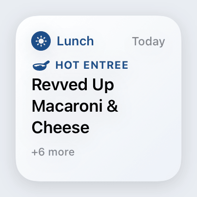
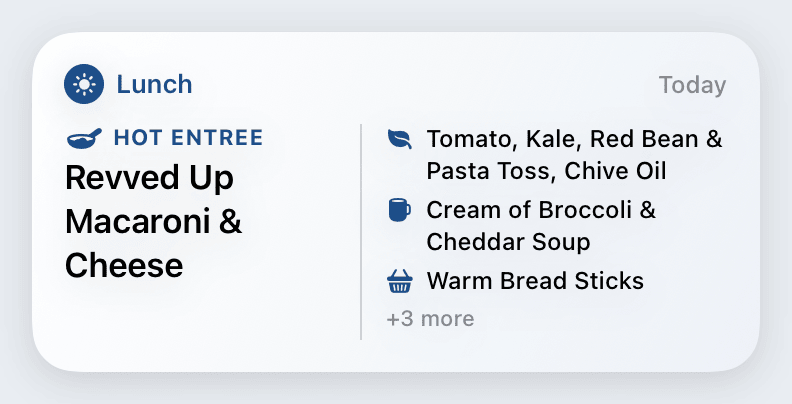
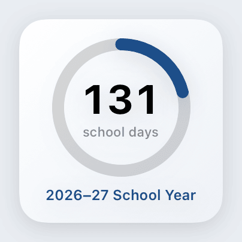
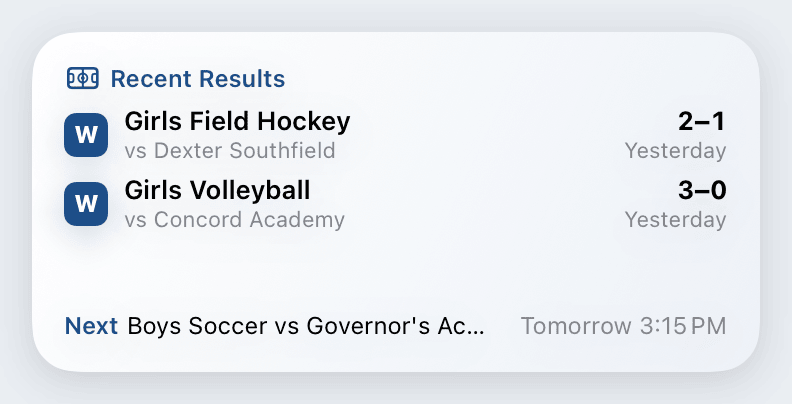
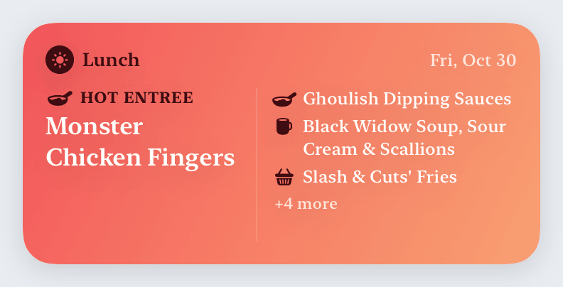
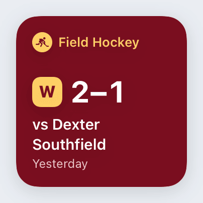
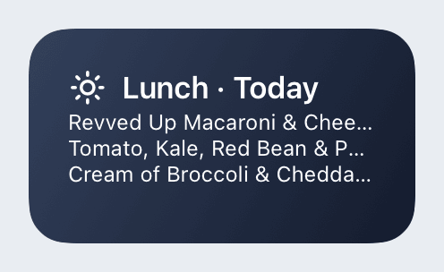
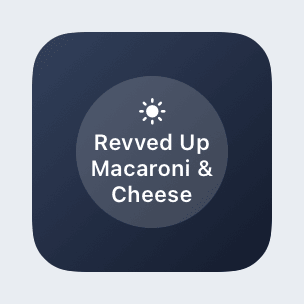
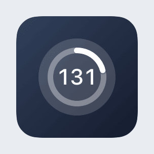
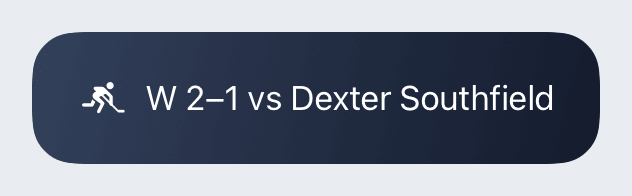

# Nobles Tools

An iOS app for designing Home Screen and Lock Screen widgets for Noble and Greenough School.

Every widget comes in all six sizes: Small, Medium and Large on the Home Screen, and circular, rectangular and inline on the Lock Screen.

| Widget | Shows |
| --- | --- |
| **Dining Menu** | Lunch, dinner, or whichever meal is next, from the Flik dining menus. Styles: Everything, Just Entrées, No Salads or Soups, Just… (stations you pick), Everything Except…. A **featured dish** leads every size and is the one dish shown on the Lock Screen. You pick its station (Hot Entree, Vegan Entree, Soup…), or let it pick the first entrée. |
| **Countdown** | Days left in the current quarter, semester or school year, counted as school days, weekdays or calendar days. Number, ring or bar style. |
| **Scores** | Recent Nobles results and upcoming games, filtered by sport. |

Every widget also has a theme (palette, font and background). Make as many designs as you like in the app, then add a Nobles Tools widget to your Home Screen, long-press it, choose **Edit Widget**, and pick a design.

## Gallery

These images are rendered by CI from the widgets' own views with sample data (`App/Previews/WidgetGallery.swift`). Every size and variant is in [`docs/widgets`](docs/widgets).

<p>
  
  
</p>
<p>
  
  
</p>
<p>
  
  
</p>
<p>
  
  
  
  
</p>

## Building

Requirements: Xcode 26 (CI builds with Xcode 26.3).

```sh
git pull
open NoblesTools.xcodeproj
```

Pick an iPhone simulator and press Run. That's all the setup there is: CI generates the Xcode project from `project.yml` and commits it every time it changes.

**Signing:** the project signs with team `6W4ZKDHBVD` and bundle ID `app.dabora.noblestools`, so it runs on your iPhone too. Both are set in `project.yml` and `Config/Signing.xcconfig`, which CI generates the project from. Don't change signing in Xcode's Signing & Capabilities tab, because CI's next regeneration replaces edits made there (CI fails and lists them if that happens). To use a different team on one Mac only, create the gitignored `Config/Local.xcconfig` containing `DEVELOPMENT_TEAM = <team ID>`.

**Changing the project:** edit `project.yml` rather than Xcode's project settings, and push. CI regenerates `NoblesTools.xcodeproj` a few minutes later; pull to get it. To regenerate locally, run `brew install xcodegen && xcodegen generate`.

- If a pull right after files were added or removed doesn't build, CI hasn't committed the regenerated project yet. Wait for its "Regenerate Xcode project" commit and pull again.
- If Xcode offers to update the project to recommended settings, decline. If a pull ever complains that local changes to the project would be overwritten, run `git restore NoblesTools.xcodeproj` and pull again.

The core logic lives in the `NoblesKit` Swift package and is tested on its own:

```sh
swift test --package-path NoblesKit
```

## Data sources

- **Menus:** Flik Independent School Dining, served by Nutrislice
  (`https://nobleandgreenough.api.flikisdining.com/menu/api/weeks/school/noble-and-greenough-school/menu-type/{lunch|dinner}/YYYY/MM/DD/`).
  Nobles publishes only lunch and dinner; there is no breakfast menu (`menu-type/breakfast` returns 404). Menu types are discovered from `/menu/api/schools/`, so a breakfast menu would appear automatically if Flik ever adds one.
- **Scores:** Nobles Athletics (`https://nobilis.nobles.edu/Athletics/`). Results come from the JSON behind its Latest Results page, and upcoming games from its Upcoming Schedule. Both are undocumented and have **final scores only**. No official live, in-game score source exists for Nobles (see `CONTEXT.md`).
- **School calendar:** Nobles' full calendar is only available after logging in, so the built-in 2026–27 quarter, semester and break dates are **estimates**. Graduation (June 4, 2027) is the only date with high confidence. You can correct the dates in the app under **Settings → School Calendar**.

The **Live API smoke test** workflow checks the menu and athletics endpoints every week and can be run manually from the Actions tab.
